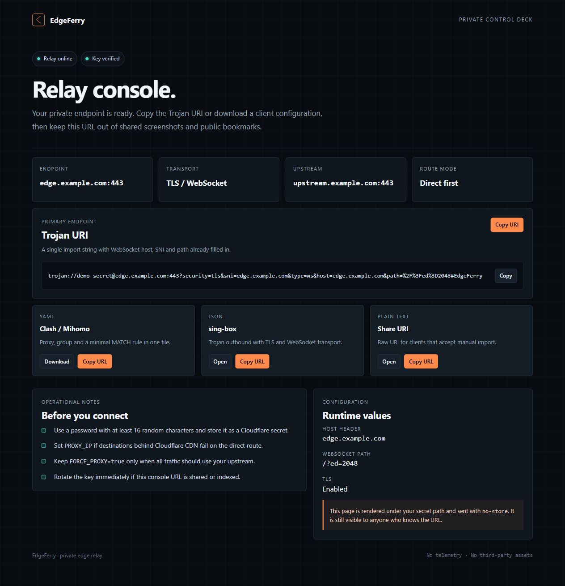

# EdgeFerry

一个部署在 Cloudflare Workers / Pages 上的私有 Trojan over WebSocket 中继。项目包含独立实现的协议处理、Cloudflare CDN 上游回退、现代化控制台，以及 Clash / sing-box 配置导出。

> EdgeFerry 依据公开的 Trojan 协议和 Cloudflare Workers Socket API 独立编写，不包含原第三方项目的源码、品牌或文档。



入口页设计见 [docs/landing.jpg](docs/landing.jpg)。

## 特性

- Trojan over WebSocket，单文件 `_worker.js` 部署；
- 支持 Cloudflare Workers 和 Pages；
- 通过 `PROXY_IP` 接入自己的上游，解决部分 Cloudflare CDN 网站无法直连的问题；
- 可选用 `FORCE_PROXY=true` 让所有连接走上游；
- 支持 `sec-websocket-protocol` 早期数据，兼容常见客户端；
- 每次请求单独读取环境变量，不使用跨请求全局状态；
- 私密控制台位于 `/<PASSWORD>`，不会在首页展示密码；
- 一键导出 Trojan URI、Clash YAML 和 sing-box JSON；
- 无数据库、无会话、无第三方前端资源、无遥测；
- 内置 SHA-224 实现和协议解析测试。

## 文件结构

```text
_worker.js       Cloudflare Worker 单文件入口
wrangler.toml    Workers 部署配置
docs/            实际渲染的界面截图
tests/           SHA-224、协议解析和页面渲染测试
scripts/         本地预览生成器
```

## 部署到 Cloudflare Workers

1. 安装依赖：

```bash
npm install
npx wrangler login
```

2. 配置访问密钥。密钥只保存为 Cloudflare Secret，不要写进仓库：

```bash
npx wrangler secret put PASSWORD
```

3. 可选配置上游。访问 Cloudflare CDN 后的网站失败时，设置你自己的稳定上游：

```bash
npx wrangler secret put PROXY_IP
```

`PROXY_IP` 支持以下格式：

```text
host.example.com
host.example.com:443
203.0.113.10
203.0.113.10:8443
[2001:db8::1]:443
```

4. 部署：

```bash
npx wrangler deploy
```

5. 打开：

```text
https://<你的域名>/<PASSWORD>
```

## 部署到 Cloudflare Pages

1. 在 Cloudflare Pages 中创建项目，上传本仓库；
2. 将 `_worker.js` 放在项目根目录；
3. 在 Pages 设置中添加环境变量：

```text
PASSWORD=至少16位随机字符
PROXY_IP=你的上游域名或IP
PROXY_PORT=443
FORCE_PROXY=false
SITE_NAME=EdgeFerry
```

4. 重新部署后访问 `https://<pages域名>/<PASSWORD>`。

## 环境变量

| 变量 | 必填 | 默认值 | 说明 |
| --- | --- | --- | --- |
| `PASSWORD` | 是 | 无 | 6-64 位字母、数字、点、下划线或短横线；建议 16 位以上随机值 |
| `PROXY_IP` | 否 | 空 | Cloudflare CDN 上游地址，直连失败时自动回退 |
| `PROXY_PORT` | 否 | `443` | 上游默认端口 |
| `FORCE_PROXY` | 否 | `false` | `true` 时所有连接优先走上游 |
| `SITE_NAME` | 否 | `EdgeFerry` | 控制台显示名称 |
| `ENDPOINT_HOST` | 否 | 当前域名 | 写入分享链接的公网入口 |
| `ENDPOINT_PORT` | 否 | `443` | 写入分享链接的入口端口 |
| `SNI` | 否 | 当前域名 | TLS SNI 和 WebSocket Host |
| `WS_PATH` | 否 | `/?ed=2048` | WebSocket 路径 |
| `TLS` | 否 | `true` | 分享链接是否声明 TLS |

## 私人路径

假设 `PASSWORD=my-private-key`：

| 路径 | 内容 |
| --- | --- |
| `/` | 入口页，只显示状态，不显示密钥 |
| `/my-private-key` | 私人控制台 |
| `/my-private-key/uri` | 原始 Trojan URI |
| `/my-private-key/clash` | Clash / Mihomo YAML |
| `/my-private-key/singbox` | sing-box JSON |
| `/my-private-key/json` | 非敏感运行时信息 |
| `/healthz` | 健康检查 |

WebSocket 客户端可以连接任意路径。单节点临时覆盖上游时，可在路径中加入：

```text
/pyip=host.example.com:443
```

## 本地测试

项目不依赖测试框架：

```bash
npm test
```

测试会校验：

- SHA-224 已知向量；
- Trojan 头部解析；
- 密码错误和命令错误；
- 页面渲染和服务端转义。

生成并预览界面：

```bash
npm run preview
```

打开 `http://127.0.0.1:4173/`。演示控制台位于 `http://127.0.0.1:4173/demo`。

## 安全说明

- 不要把 `PASSWORD`、控制台 URL 或导出的配置提交到公开仓库；
- 控制台虽然位于秘密路径，但仍然属于“知道 URL 即可访问”，不要当作完整身份认证；
- 暴露密钥后立即旋转 `PASSWORD`；
- 只处理自己有权访问的网络和目标；
- 遵守 Cloudflare 服务条款、当地法律和目标网站的使用规则；
- 不建议将本项目用于绕过付费墙、攻击、扫描或未经授权的访问。

## License

MIT
